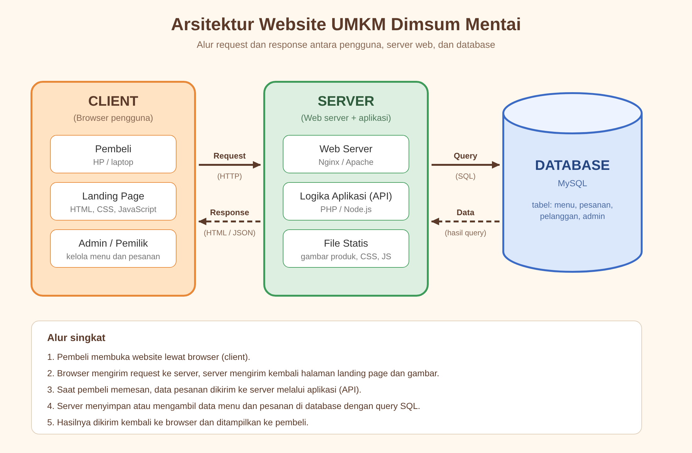
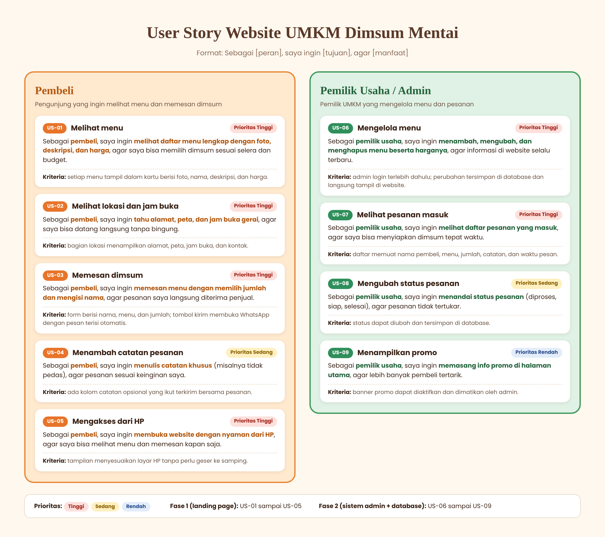

# Tugas Website UMKM Dimsum Mentai
NATASYA HALA

Project landing page dan dokumentasi perancangan sistem untuk UMKM Dimsum Mentai.

## 1. Arsitektur Website

## 2. User Story

## 3. Landing Page

Landing page dibangun menggunakan HTML5, CSS3, dan JavaScript interaktif dengan fitur pemesanan otomatis via WhatsApp.